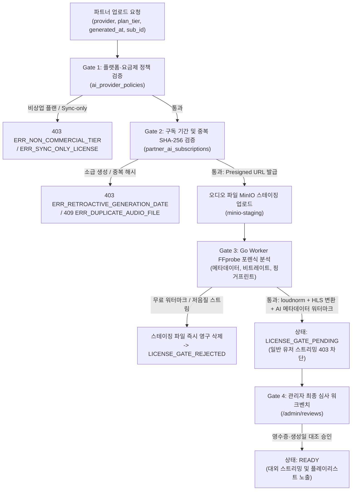

# AVIBE Streaming Platform (AI 음원 스트리밍 플랫폼)

> **상업용 라이선스 원천 차단 & 법적 컴플라이언스 완전판**  
> AI 생성 음원을 유통·스트리밍하고, 백그라운드 재생 및 플레이리스트 큐레이션을 제공하는 풀스택 모바일(Flutter) 및 웹(Vue 3) 플랫폼입니다.

---

## 1. 핵심 아키텍처 및 4단계 상업 라이선스 게이트키퍼

비상업용 음원(무료 요금제, 소급 적용 불가 기간 생성물, 영상 배경음악 전용 라이선스 등)의 플랫폼 유입을 100% 원천 차단하기 위한 4중 게이트키퍼 파이프라인을 운영합니다.



### 7대 AI 플랫폼 상업 라이선스 매트릭스 (`ai_provider_policies`)
- **Suno (`SUNO`)**: `Pro`, `Premier` 허용 / `Free (Basic)` 차단 / 무료 시절 생성물 소급 적용 차단
- **Udio (`UDIO`)**: 상업 유통 허용 유료 플랜만 허용 / `Free` 차단
- **AIVA (`AIVA`)**: `Pro` 허용 / `Standard` (영상 BGM Sync 전용) 및 `Free` 차단
- **Stable Audio (`STABLE_AUDIO`)**: `Pro`, `Creator` 허용 / `Free` 차단
- **Soundraw (`SOUNDRAW`)**: 아티스트 단독 유통 플랜만 허용 / `Creator`, `Pro` (영상 BGM Sync 전용) 차단
- **Mubert (`MUBERT`)**: 아티스트/엔터프라이즈 플랜만 허용 / `Creator`, `Pro` 차단
- **Custom Open Model (`CUSTOM_OPEN_MODEL`)**: `Apache-2.0`, `MIT` 허용 / `CC-BY-NC` 비상업 가중치 모델 차단

---

## 2. 프로젝트 디렉토리 구조

```text
AImusic/  <!-- physical checkout name; product brand is AVIBE -->
├── backend/                       # Go 1.22 REST API & 비동기 미디어 트랜스코딩 워커
│   ├── cmd/api/                   # API 서버 엔트리포인트 (Gin)
│   ├── cmd/worker/                # FFprobe 라이선스 포렌식 & FFmpeg HLS 워커
│   ├── internal/pkg/licensegate/  # 4단계 상업 라이선스 검증 엔진
│   ├── internal/pkg/audio/        # FFprobe 분석기 & FFmpeg HLS/워터마크 래퍼
│   ├── internal/pkg/crypto/       # AES-256-GCM 금융정보 암호화 & HLS Signed URL
│   └── migrations/                # PostgreSQL 16 DDL 및 초기 정책/약관 시드
├── web/                           # Vue 3 + Vite + TypeScript 통합 웹 포털
│   ├── src/views/partner/         # 상업 라이선스 사전검증 3단계 업로드 위저드
│   ├── src/views/admin/           # 심사 워크벤치 & 라이선스 정책 실시간 편집 콘솔
│   └── src/views/user/            # 유저 스트리밍, 파형 시크바, UGC 아티스트 차단
├── mobile/                        # Flutter 크로스플랫폼 모바일 앱 (iOS / Android)
│   └── lib/services/audio_handler.dart  # just_audio + audio_service 백그라운드 큐
├── scripts/
│   ├── start-local.sh             # 로컬 인프라 (Postgres, Redis, MinIO, API, Worker) 기동
│   └── test-e2e.sh                # 11단계 E2E 시나리오 자동 검증 스위트
└── docs/                          # API 명세, 아키텍처 다이어그램, ERD 및 Cloudflare 가이드
```

---

## 3. 로컬 실행 및 E2E 테스트

### 사전 요구사항
- Docker Desktop (Docker Compose v2)
- Go 1.22+
- Node.js 20+
- Flutter 3.24+

### 1) 로컬 스택 기동
```bash
# PostgreSQL 16, Redis 7, MinIO, Go API (:8080), Media Worker 원클릭 실행
bash scripts/start-local.sh
```

### 2) E2E 시나리오 자동화 테스트 실행
```bash
# 11단계 시나리오 (비상업 요금제 차단, FFprobe 포렌식, Gate 4 심사, HLS 스트리밍, 임시조치 등) 검증
bash scripts/test-e2e.sh
```

### 3) 프론트엔드 실행
```bash
# Web (Vue 3)
cd web
npm install
npm run dev

# Mobile (Flutter)
cd mobile
flutter pub get
flutter run
```

---

## 4. 규제 및 법적 컴플라이언스

1. **대한민국 인공지능기본법 제31조 (투명성 확보 의무)**
   - UI 전역 및 모바일 잠금화면 알림에 `[AI 생성 음원]` 투명성 배지 상시 노출
   - FFmpeg 트랜스코딩 시 오디오 헤더에 대한민국 AI 기본법 준수 메타데이터(`AIWatermarkComment`) 자동 삽입
2. **저작권법 제102조~제104조 OSP 면책 특권 확보**
   - 권리침해 신고 접수 즉시 스트리밍을 차단(`TAKEDOWN_TEMP`)하는 **Notice & Takedown** 워크플로우
   - 3회 이상 침해 시 삼진아웃 계정 정지 및 정산금 몰수(`FORFEITED_VIOLATION`)
3. **개인정보보호법 및 글로벌 앱 마켓(Apple/Google) UGC 가이드라인**
   - 파트너 계좌번호 및 주민번호/사업자번호 `AES-256-GCM` 암호화 저장
   - 모바일/웹 내 **[트랙 신고]** 및 **[아티스트 즉시 차단(재생 큐에서 자동 제거)]**, **[인앱 즉시 회원 탈퇴]** 완비
