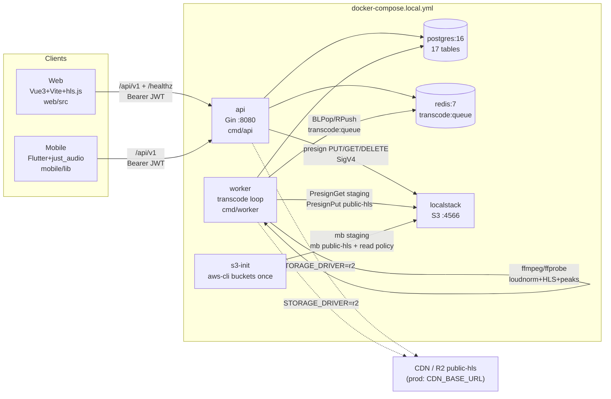

# Architecture (Phase 5)

Stack: Go 1.22 API + worker (`backend/`), PostgreSQL 16, Redis 7,
S3-compatible storage (LocalStack S3 local, Cloudflare R2 staging/prod),
Vue 3 web (`web/`) + Flutter mobile (`mobile/`).
Local topology: `docker-compose.local.yml` (`avibe-local`).

## Runtime diagram (Mermaid)

Images: `api`/`worker` built from `backend/Dockerfile`
(`golang:1.22-alpine` → `alpine:3.20 + ffmpeg`), same binary source, different `command`.
Health: `postgres pg_isready`, `redis redis-cli ping`, `localstack /_localstack/health`,
`api wget /healthz`, `worker pgrep -f ./worker`.

## Backend (`backend/`)

Entry: `cmd/api/main.go` — `config.Load()` → `OpenDB(pgx stdlib, 25/5/5m)` →
`NewRedisClient` → `storage.NewFromEnv()` → `repository.New(db,rdb)` →
`service.New(...)` → `handler.SetupRouter` → `http.Server(:8080, 15s/30s/60s)`.
Entry: `cmd/worker/main.go` — same repos/storage, `signal.NotifyContext`, loop
`DequeueTranscode(BLPop 10s)` → `process()` (see Transcode below), plus two
idempotent sweeper goroutines: dispute-SLA alerts (`sla.go`, 72h default) and
stuck-job requeue (`reap.go`, 30m default, ≤3 attempts).

Layers:

- `internal/config`: `APP_ENV/APP_ADDR`, `DB_*`/`DB_DSN`, `REDIS_*`, storage
  (`S3_*` or `R2_*` when `STORAGE_DRIVER=r2`, `CDN_BASE_URL`),
  `JWT_*`, `AES256_KEY_BASE64` (32B), `HLS_SIGNING_KEY`/`HLS_URL_TTL_SECONDS=300`.
- `internal/handler` (Gin): `SetupRouter` groups `/healthz`+`/readyz` (503 when degraded), `/api/v1/{auth,legal,
  partner,tracks,playback,playlists,disputes,admin}`; middleware `Recovery`,
  `AuditLog` (method/path/status/user/role/ip/latency), `RateLimit`,
  `JWTAuth` (Bearer HS256 `access`), `RequireRole`, `RequireAgeConfirmed` (14+), `RequireConsents` (required terms); envelope `ok/created/abort`,
  `AbortError` maps `GateError`/`Err*` (see `docs/API.md`).
- `internal/service`: `Auth` (bcrypt+JWT issue/parse/refresh), `Precheck`
  (gate + `PresignPut staging/<partner>/<sha>/<base>, 15m, 900s`), `Finalize`
  (track+rights+job+`RPush`), `Review` (pending queues, track/partner/subscription),
  `DisputeService` (report/counter/resolve/takedown + 3-strike + §103 timeline),
  `PlaylistService` (owner checks, `READY`-only add), `PlaybackService`
  (cumulative 30s valid stream across ~10s heartbeat deltas, 120/h +
  40/h/track counted-play fraud), `SettlementService` (3.3‰ `33/1000` business
  or 8.8‰ `88/1000` other income, `FORFEITED_VIOLATION`).
  Default settlement rate 10 KRW/play (`service.New`).
- `internal/repository` (`database/sql` pgx + `go-redis`): `Users/Partners/
  Subscriptions/Policies/Legal/Albums/Tracks/Rights/Jobs/Disputes/Playlists/
  Playback/Streaming/Settlements/Blocks/Gate/Queue` (`queue.go:Repos` aggregate).
  `GateStore` implements `licensegate.Store` (SHA LIKE, policy, subscription);
  `Queue` is `transcode:queue` (`RPush`/`BLPop`/`LLen`).
- `internal/pkg/licensegate`: `ValidateCommercialEligibility` (duplicate→409,
  `allows_standalone_streaming`→`ERR_SYNC_ONLY_LICENSE`, generation cutoff
  `max_generated_at`→`ERR_NON_COMMERCIAL_TIER`, verified-window→
  `ERR_RETROACTIVE_GENERATION_DATE`/`ERR_NON_COMMERCIAL_TIER`).
- `internal/pkg/audio`: `RunFFprobe` (format+audio stream, tags, bitrate),
  `CheckBlockedMetadata` (case-insensitive key+value substring),
  `CheckBitrate` (WAV/FLAC/AIF(F)/CAF or PCM/FLAC/ALAC bypass; lossy needs
  `>0` and `>=min`), `BuildHLSArgs/Command` (`loudnorm`, `comment/ai_provider/
  ai_tier` metadata, `128k/256k AAC`, `6s VOD`, `master.m3u8`, `stream_%v.m3u8`),
  `ExtractWaveform` (mono 8kHz f32 → 100 normalized peaks) + `WaveformJSON`.
- `internal/pkg/storage`: `S3Compat` SigV4 query presign (`PresignPut/Get`,
  `Delete`; 15m default, 7d cap) + `NewFromEnv` (local vs R2 buckets
  `local-staging`/`local-hls`).
- `internal/pkg/crypto`: AES-256-GCM `Cipher` (settlement accounts),
  `Sign/VerifyPlaybackToken` (HMAC `trackId|jti|exp`), `BuildSignedPlaybackURL`
  (`exp/jti/sig`), `SHA256Hex`.
- `internal/domain`: roles/providers/statuses/reasons/settlement enums,
  17 entities, `GateError` + `Code*` + `ForfeitViolation`.

## Storage & buckets

- Local S3 (LocalStack `localstack/localstack:4.0`, `SERVICES=s3`, :4566):
  `S3_STAGING_BUCKET=local-staging` (private),
  `S3_PUBLIC_HLS_BUCKET=local-hls` (public-read bucket policy).
  `s3-init` (`amazon/aws-cli`) creates both idempotently.
  (MinIO was dropped: its official Docker Hub repos no longer exist upstream.)
- Prod template (`.env.example`, `config.loadStorage`): `R2_*` + `CDN_BASE_URL`
  when `STORAGE_DRIVER=r2` (endpoint `https://<account>.r2.cloudflarestorage.com`,
  region `auto`, SSL always).
- Keys: staging `staging/<partnerId>/<sha>/<basename>` (embeds SHA for dedupe);
  HLS `hls/<trackId>/{master.m3u8,stream_*.m3u8,seg_*.ts,peaks.json}`.

## Core flows

### Upload → license gate → transcode → HLS

1. `POST /partner/pre-check` (JWT PARTNER): gate passes → `{stagingKey,uploadUrl}`.
2. Client `PUT` bytes to `uploadUrl` (direct to S3/R2, no API proxy).
3. `POST /partner/finalize`: `tracks UPLOADED` + `track_rights_declarations` +
   `transcoding_jobs QUEUED` + `RPush transcode:queue{jobId,trackId,inputBucket,
   inputKey,outputPrefix}`.
4. Worker `BLPop` → `MarkRunning` + `TRANSCODING` → policy lookup →
   download (`PresignGet`) → `ffprobe` → blocked-keyword gate (Korean
   `차단된 메타데이터 키워드 감지: <kw>` → `FAILED`+`LICENSE_GATE_REJECTED`) →
   bitrate gate (`비트레이트 기준 미달` → same) → `ffmpeg loudnorm→HLS`
   (30m timeout) → `peaks.json` (best-effort) → upload dir (`PresignPut` each)
   → `MarkSucceeded` + `SetTranscoded(READY,hls_prefix,bitrate,duration)`.
   Transient failures requeue until `attempts>=3` → `LICENSE_GATE_REJECTED
   (attempts exhausted)`.
5. Admin `POST /admin/review approve` (READY stays READY; curation-visible).
6. `GET /tracks/:id/stream` (JWT, READY only, login required) → signed playlist URL: `master.m3u8` for pass holders/admins (HQ 256k), `stream_0.m3u8` for free tier (SQ 128k)
   (TTL 300s); client plays via `hls.js` (web) / `just_audio` (mobile);
   `POST /playback/heartbeat` counts 30s+ plays.

### Generation → stage → register (WI-03, setup-only)

1. `POST /partner/generations` (JWT PARTNER): validates prompt/model →
   `generation_jobs QUEUED` + `RPush generation:queue{jobId}`.
2. Worker generation loop `BLPop` → `MarkRunning` → `POST
   {GENERATION_BACKEND_URL}/generate` (reference: `generator/server.py`) →
   WAV bytes staged to `staging/` under a canonical key (SHA-256 bound) →
   `MarkSucceeded(outputObjectKey,durationMs)`. No backend URL →
   `DisabledBackend` fails the job with a message (retried ≤3, then FAILED).
3. Partner runs normal PreCheck/Finalize with the staged file's SHA-256 to
   register the track. No GPU runs in this repo.

### Store → device → certified plays (WI-05 #19/#20/#21)

1. Partner `POST /partner/stores` (biz-no checksum) → `PENDING`; admin
   `POST /admin/stores/:id/verify` → `APPROVED`.
2. Partner creates device → 8-char pairing code (15min, ≤ license cap);
   player `/store/player` claims → long-lived device token (sha256 stored).
3. Player polls `GET /store/device/queue` (schedule-aware: hours/closed-day/
   playlist or official-curation fallback; READY+HLS only) → `GET
   /store/device/stream/:id` HQ grants → hls.js → `POST
   /store/device/heartbeat` (30s+ counted).
4. `store_play_logs` counted plays settle at the same 10KRW rate via
   `StoreRepo.CountPartnerPlaysInWindow` in `SettlementService.Calculate`.

### Dispute → takedown → strike → settlement

- `POST /disputes/report` → `OPEN`; `POST /admin/curation/takedown` → immediate
  `TAKEN_DOWN` (temp blind); taken-down is skipped everywhere (`ERR_NOT_STREAMABLE`
  on stream/heartbeat/playlist-add, excluded from `ListReady`/`TopByPlays`).
- `POST /disputes/:id/counter` (owner) → `UNDER_REVIEW` + `[COUNTER]`.
- `POST /admin/disputes/:id/resolve uphold=false` → `DISMISSED` (no strike);
  re-approve restores `READY`. `uphold=true` → `UPHELD_TAKEDOWN` + `TAKEN_DOWN` +
  `strike_applied` + `user_blocks(strike_number 1..3)`; #3 suspends partner.
- `POST /admin/settlements/calculate` applies the 70:30 canon: admin-attested
  `storePoolKrw` splits by qualified 30s+ store-play seconds, `directKrw`
  attributes in full, partner keeps 70%, withholding applies;
  violated (suspended/terminated or upheld>0) → `FORFEITED/FORFEITED_VIOLATION/
  net=0`, else `PENDING`; `approve` → `APPROVED` (never from `FORFEITED`).

## Frontend

- Web (`web/`, `avibe-web 0.1.0`): `vue 3.4 + vite 5 + vue-router 4 + pinia 2 +
  axios + hls.js + tailwind 3`. `src/api/{client,endpoints,types}` (typed wrappers,
  `ERR_MESSAGES` Korean, Bearer+refresh), `src/router` (`/`, `/partner/*`
  PARTNER|ADMIN, `/admin/*` ADMIN, `requiresAuth` guard), `src/layouts`
  (User/Partner/Admin), `src/views/{user/{Home,Login,PlaylistDetail,
  DisputeCenter},partner/{Dashboard,Upload,Subscriptions},admin/{Reviews,
  LicensePolicies,Disputes,Curation}}`, `src/components/{legal/{AiBadge,
  DisputeReportModal,LicensePrecheckWidget},player/{GlobalPlayerBar,
  QueueDrawer,WaveformSeekbar}}`, `src/stores/{authStore,partnerUploadStore,
  playerStore,playlistStore}`. Scripts: `dev/build/preview/typecheck`.
- Mobile (`mobile/`, `avibe 0.4.0`): `flutter_riverpod+dio+go_router+
  just_audio+audio_service+audio_session+flutter_secure_storage`.
  `lib/{main.dart,core/{api_client,env,error,models,providers,theme},
  features/{auth/login_screen,home/home_screen,legal/legal_screens,
  player/{player_controller,player_screen},playlist/playlist_screens,
  search/search_screen},services/{api_service,audio_handler,auth_repository}}`.
  `ApiService` covers tracks/stream/playback/playlists/disputes/legal with the
  same `/api/v1` URIs; `StreamTicket.getStream` surfaces `ERR_NOT_STREAMABLE`.

## Config & local ops

- `.env.example`: `DB_*` (5432), `REDIS_*` (6379), `S3_*` (4566,
  `local-staging`/`local-hls`), `CDN_BASE_URL` (local HLS base), `API_PORT=8080`,
  `JWT_*`, `AES256_KEY_BASE64` (32B), `HLS_SIGNING_KEY`/`HLS_URL_TTL_SECONDS`,
  R2/CDN template (commented).
- `scripts/start-local.sh`: `.env` bootstrap → `compose up --build -d` →
  waits (pg_isready/redis ping/localstack health/s3-init/api healthz/worker pgrep) →
  idempotent migrate (`to_regclass(users)` gate for `000001_init.up.sql`) + always
  `seed.sql` (`ON CONFLICT`-safe) → `compose ps`.
- `scripts/test-e2e.sh`: `curl+psql+redis-cli` PASS/FAIL suite (T01 health …
  T11 settlement; see header mapping for gate/dispute/strike/forfeiture cases).
  No `docker`/`network` needed beyond the already-running local stack.

## Security & ops notes

- Secrets never committed (`.env` gitignored, `.env.example` placeholders;
  `openssl rand` generators in comments). Passwords bcrypt, settlement accounts
  AES-256-GCM, JWT HS256 split access/refresh secrets, HLS URLs short-lived HMAC.
- Abuse controls: license gate (policy+subscription+SHA), worker metadata/bitrate
  gates, playback fraud windows, playlist READY-only, 3-strike + forfeiture,
  rate limits + audit log per request.
- Scaling seams: stateless `api` (add replicas behind LB; move `RateLimiter`
  to Redis for multi-replica), `worker` (add consumers; `BLPop` FIFO),
  `postgres` (read replicas for `ListReady/TopByPlays`), storage/CDN (R2+CDN),
  Redis queue depth `LLEN transcode:queue` as autoscale signal.
