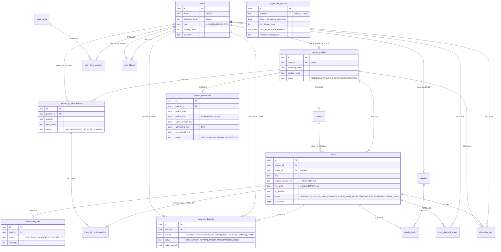

# ERD (Phase 5)

Source of truth: `backend/migrations/000001_init.up.sql` (17 tables),
`backend/internal/domain/entities.go` (Go mirrors), `backend/internal/repository/*.go`
(access), `backend/migrations/seed.sql` (policy matrix + demo rows).
Conventions: UUID PKs `gen_random_uuid()`, `TIMESTAMPTZ`, `CHECK` enums,
`set_updated_at()` trigger on mutable tables.

## Diagram (Mermaid)

## Tables (all 17)

### 1. `users`
`id, email UNIQUE, password_hash (bcrypt), role CHECK(ADMIN|PARTNER|USER) DEFAULT USER,`
`display_name, is_active DEFAULT TRUE, birth_year? (C9 optional), age_confirmed_at? (C9 14+ evidence),`
`created_at, updated_at`.
Repo: `UserRepo` (`Create/CreateWithProfile/GetByID/GetByEmail/SetActive`).

### 2. `partner_profiles`
`id, user_id UNIQUE FK users CASCADE, company_name, business_number?,`
`settlement_bank?, settlement_account_encrypted? (AES-256-GCM base64, see `pkg/crypto`),`
`contact_email, status CHECK(PENDING|APPROVED|SUSPENDED|TERMINATED) DEFAULT PENDING,`
`approved_at?, created_at, updated_at`.
Repo: `PartnerRepo` (`Create/GetByID/GetByUserID/ListByStatus/UpdateStatus/UpdateSettlement`).
`UpdateStatus(approved=true)` stamps `approved_at=NOW()`.

### 3. `ai_provider_policies`
`id, provider UNIQUE CHECK(SUNO|UDIO|AIVA|STABLE_AUDIO|SOUNDRAW|MUBERT|CUSTOM_OPEN_MODEL),`
`allows_standalone_streaming, min_bitrate_kbps DEFAULT 192 CHECK>0,`
`blocked_metadata_keywords TEXT[] DEFAULT '{}', rejection_message_ko, commercial_terms_url?,`
`max_generated_at? (B2 generation cutoff), terms_snapshot_url?, terms_checked_at? (C4, stamped on every admin save)`.
Seed: SUNO/UDIO/AIVA/STABLE/CUSTOM `TRUE`; SOUNDRAW/MUBERT `FALSE` (SYNC-only);
UDIO `max_generated_at=2025-10-30`.
Repo: `PolicyRepo` (`Get/List/Update` via `string_to_array(chr(31))`).
Gate view: `licensegate.Policy` (includes `MaxGeneratedAt`).

### 4. `partner_ai_subscriptions`
`id, partner_id FK CASCADE, provider CHECK(7), plan_name, proof_object_key?,`
`status CHECK(PENDING|VERIFIED|REJECTED|EXPIRED) DEFAULT PENDING,`
`verified_by? FK users SET NULL, verified_at?, expires_at?, created_at, updated_at,`
`UNIQUE(partner_id,provider)`, index `(partner_id)`.
Repo: `SubscriptionRepo` (`Create/GetByID/GetByPartnerProvider/ListByPartner/ListPending/UpdateVerification` sets `verified_at=NOW()`).
Seed: one `SUNO Pro VERIFIED` for the demo partner, `expires_at NOW()+30d`.

### 5. `legal_terms`
`id, code CHECK(TOS|PARTNER_CONTRACT|PRIVACY|COPYRIGHT_POLICY), version,`
`title_ko, body_md DEFAULT '', is_required DEFAULT TRUE, effective_at DEFAULT NOW(),`
`created_at, UNIQUE(code,version)`.
Seed: 4 rows `v1.0` pointing at `docs/legal/*.md`.

### 6. `user_term_consents`
`id, user_id FK CASCADE, terms_id FK RESTRICT, consented_at DEFAULT NOW(), ip?, user_agent?,`
`UNIQUE(user_id,terms_id)`, index `(user_id)`.
Repo: `LegalRepo.CreateConsent` is `ON CONFLICT DO NOTHING` (idempotent).

### 7. `albums`
`id, partner_id FK CASCADE, title, cover_object_key?,`
`release_type CHECK(SINGLE|EP|ALBUM) DEFAULT SINGLE,`
`status CHECK(DRAFT|PENDING_REVIEW|LIVE|TAKEN_DOWN) DEFAULT DRAFT,`
`released_at?, created_at, updated_at`, index `(partner_id)`.

### 8. `tracks`
`id, album_id? FK SET NULL, partner_id FK CASCADE, title, duration_ms? CHECK>0,`
`original_object_key NOT NULL (staging key embeds client SHA-256; duplicate check is`
`LIKE '%sha%' in `GateStore.AudioHashExists` / `TrackRepo.ExistsByHash`),`
`hls_prefix? (set on transcode, `hls/<trackId>`), ai_provider CHECK(7),`
`ai_generated DEFAULT TRUE, ai_disclosure_text?, bitrate_kbps? CHECK>0,`
`isrc? UNIQUE (WI-05, admin-assigned canonical 12-char), bpm? REAL 30..300 + musical_key?`
`(WI-05, worker best-effort detection, NULL when unsuitable),`
`status CHECK(UPLOADED|LICENSE_GATE_PENDING|LICENSE_GATE_REJECTED|TRANSCODING|READY|TAKEN_DOWN) DEFAULT UPLOADED,`
`rejection_reason_ko?, play_count DEFAULT 0, created_at, updated_at,`
indexes `(partner_id)`, `(status)`, `(isrc)`.
Lifecycle: `Finalize→UPLOADED` → worker `TRANSCODING` → `READY` (`SetTranscoded`)
or `LICENSE_GATE_REJECTED`; admin `ReviewTrack` → `READY`/`LICENSE_GATE_REJECTED`;
dispute uphold / takedown → `TAKEN_DOWN`.

### 9. `track_rights_declarations`
`id, track_id UNIQUE FK CASCADE, partner_id FK CASCADE,`
`declares_ownership/no_voice_clone/training_consent DEFAULT FALSE,`
`source_model?, subscription_id? FK SET NULL,`
`collective_trust_status DEFAULT 'NONE' (C3; TRUSTED refused), collective_name?, declared_at,`
`cert_snapshot_json? + cert_snapshot_at? (WI-02 track-level cert snapshot, 000008)`.
Repo: `RightsRepo.Upsert` (`ON CONFLICT(track_id) DO UPDATE`) + `SetCertSnapshot` (worker recheck refresh).

### 10. `transcoding_jobs`
`id, track_id FK CASCADE, status CHECK(QUEUED|RUNNING|SUCCEEDED|FAILED) DEFAULT QUEUED,`
`input_object_key, output_prefix?, bitrate_kbps? CHECK>0, error?, attempts DEFAULT 0,`
`started_at?, finished_at?, created_at, updated_at`, indexes `(track_id)`, `(status)`.
Worker (`cmd/worker`): `MarkRunning` → ffprobe/blocked-keyword/bitrate gates →
ffmpeg HLS → `MarkSucceeded`+`Tracks.SetTranscoded`, else `MarkFailed` (attempts+1;
license rejects → `LICENSE_GATE_REJECTED` immediately, transient errors requeue to
`transcode:queue` until 3 attempts).

### 11. `copyright_disputes`
`id, track_id FK CASCADE, reporter_user_id? FK SET NULL,`
`reason CHECK(AI_POLICY_VIOLATION|VOICE_CLONE|UNAUTHORIZED_SAMPLE|OTHER),`
`description DEFAULT '', status CHECK(OPEN|UNDER_REVIEW|UPHELD_TAKEDOWN|DISMISSED) DEFAULT OPEN,`
`strike_applied DEFAULT FALSE, resolved_by? FK SET NULL, resolved_at?,`
`§103 timeline (D1): takedown_requested_at? (report), partner_notified_at? (takedown/uphold),`
`resume_requested_at? + resume_scheduled_at? (+7d, counter), resumed_at? (dismiss),`
`created_at, updated_at,`
indexes `(track_id)`, `(status)`.
`AppendCounter` appends `\n[COUNTER] note` + `UNDER_REVIEW` + resume stamps; `Resolve` sets
status/strike/resolver/`resolved_at=NOW()` + resume/notice stamps; `CountUpheldByPartner` drives settlement forfeiture.

### 12. `playlists`
`id, owner_user_id FK CASCADE, title, is_public DEFAULT FALSE, created_at, updated_at,`
index `(owner_user_id)`.

### 13. `playlist_tracks`
`id, playlist_id FK CASCADE, track_id FK CASCADE, position CHECK>=0, added_at,`
`UNIQUE(playlist_id,track_id)`, index `(playlist_id)`.
`AddTrack` is idempotent (`ON CONFLICT DO NOTHING`, `COALESCE(MAX(position)+1,0)`);
`Reorder` rewrites positions transactionally (must include every id).

### 14. `user_playback_states`
`id, user_id FK CASCADE, track_id FK CASCADE, position_ms DEFAULT 0 CHECK>=0,`
`created_at, updated_at, UNIQUE(user_id,track_id)`.
`UpsertState` is `ON CONFLICT(user_id,track_id) DO UPDATE`.

### 15. `streaming_logs` (append-only)
`id, user_id?/track_id?/partner_id? FK SET NULL, played_at DEFAULT NOW(),`
`play_ms DEFAULT 0 CHECK>=0, counted_as_play DEFAULT FALSE, ip?, user_agent?, hls_token_jti?,`
indexes `(played_at)`, `(track_id)`, `(partner_id,played_at)`.
`CountPartnerPlaysInWindow` (`counted_as_play` in `[start,end)`) drives settlement;
`CountUserPlaysSince` / `CountUserTrackPlaysSince` (1h, counted plays only) drive fraud flags;
`SumPlayMsSinceLastCounted` accumulates heartbeat deltas so the 30s-crossing delta counts once.

### 16. `partner_settlements`
`id, partner_id FK CASCADE, period_start DATE, period_end DATE,`
`gross/withholding/net/play_count BIGINT DEFAULT 0 CHECK>=0,`
`status CHECK(PENDING|APPROVED|PAID|FORFEITED) DEFAULT PENDING, forfeiture_reason?,`
`paid_at?, payout_reference?` (batch 4; `mark-paid` sets both, APPROVED→PAID once).
Violation forfeits write status `FORFEITED` with `forfeiture_reason='FORFEITED_VIOLATION'`.
`income_type DEFAULT 'BUSINESS_33' (B9; OTHER_88 = 8.8%),`
`created_at, updated_at, UNIQUE(partner_id,period_start,period_end), CHECK(start<=end)`.
`Upsert` per partner+period; `Approve` refuses `FORFEITED`.
Math: `gross=plays*rate`, `withholding=gross*33/1000` (or `*88/1000`), `net=gross-withholding`,
violated (`SUSPENDED|TERMINATED` or upheld>0) → `FORFEITED/FORFEITED_VIOLATION/net=0`.

### 17. `user_blocks` (3-strike)
`id, user_id FK CASCADE, blocked_by? FK SET NULL, reason,`
`strike_number CHECK(1..3), expires_at? (NULL = permanent on #3), created_at,`
index `(user_id)`. `CountStrikes` caps display at 3; strike 3 suspends the partner.

### 18. `generation_jobs` (WI-03, setup-only)
`id, partner_id FK CASCADE, prompt, lyrics?, model DEFAULT 'ace-step-v1',`
`params_json DEFAULT '{}', status CHECK(QUEUED|RUNNING|SUCCEEDED|FAILED) DEFAULT QUEUED,`
`output_object_key?, duration_ms? CHECK>0, error?, attempts DEFAULT 0, created_at, updated_at,`
indexes `(partner_id)`, `(status)`.
Repo: `GenerationJobRepo` (Create/GetByID/ListByPartner/Mark*); queue `generation:queue`
(`EnqueueGeneration`/`DequeueGeneration`); worker stages WAV to `staging/` then partner
runs normal PreCheck/Finalize.

### 19. `store_businesses` (WI-05 #19)
`id, partner_id FK CASCADE, business_number UNIQUE (10-digit, checksum-validated),`
`store_name, license_count DEFAULT 1 CHECK>=1, status CHECK(PENDING|APPROVED|SUSPENDED) DEFAULT PENDING,`
`verified_by? FK SET NULL, verified_at?, created_at, updated_at`,
indexes `(partner_id)`, `(status)`.

### 20. `store_devices` (WI-05 #20)
`id, business_id FK CASCADE, device_name, pairing_code? + pairing_expires_at? (15min, cleared on claim),`
`device_token_hash? (sha256, cleared on revoke), status CHECK(PENDING|ACTIVE|REVOKED) DEFAULT PENDING,`
`volume DEFAULT 70 CHECK 0..100, last_seen_at?, created_at, updated_at`,
indexes `(business_id)`, partial `(pairing_code)` on live PENDING rows.

### 21. `store_schedules` (WI-05 #20)
`id, business_id FK CASCADE, weekday CHECK 0..6, open_time TIME, close_time TIME,`
`playlist_id? FK SET NULL, is_closed DEFAULT FALSE, created_at, updated_at,`
`UNIQUE(business_id, weekday)`, index `(business_id)`.
Repo: `StoreRepo.UpsertSchedule`.

### 22. `store_play_logs` (WI-05 #21)
`id, device_id FK CASCADE, track_id FK CASCADE, played_at DEFAULT NOW(),`
`duration_played_secs CHECK>=0, counted_as_play, created_at`,
indexes `(device_id, played_at)`, `(track_id, played_at)`.
`CountPartnerPlaysInWindow` feeds `SettlementService.Calculate` (same 10KRW rate).

## Seed (`seed.sql`, idempotent)

- `users`: fixed UUIDs `a000...001/002/003` (admin/partner/user, dummy bcrypt, local only)
  `ON CONFLICT(email) DO NOTHING`; `partner_profiles b000...001 APPROVED`.
- `ai_provider_policies`: 7 rows `ON CONFLICT(provider) DO UPDATE` (matrix above),
  plus batch-3 `ALTER TABLE ... IF NOT EXISTS` sync and `UDIO max_generated_at=2025-10-30`.
- `partner_ai_subscriptions c000...001`: `SUNO Pro VERIFIED`, `verified_at NOW()`,
  `expires_at NOW()+30d`, `ON CONFLICT(partner,provider) DO UPDATE`.
- `legal_terms`: 4×`v1.0` + 4×`v1.1` `ON CONFLICT(code,version) DO UPDATE`
  (`GetTermByCode` serves the latest `effective_at`, i.e. v1.1).

## Batch 2 tables (`000002_batch2`, `domain/batch2.go`)

- `password_reset_tokens`: `id, user_id FK CASCADE, token_hash UNIQUE (SHA-256),`
  `expires_at (send +15min), used_at?, created_at`. Single-use: confirm marks `used_at`.
- `oauth_accounts`: `id, user_id FK CASCADE, provider CHECK(GOOGLE|KAKAO),`
  `provider_user_id, email?, created_at, UNIQUE(provider,provider_user_id)`.
- `oauth_states`: `id, state UNIQUE, provider, redirect_uri, created_at, expires_at (+10min)`.
- `billing_plans`: `id, code UNIQUE, name_ko, amount_krw, duration_days, is_active`.
  Seed: `LISTENER_PLUS_MONTHLY` 5900 KRW / 30d.
- `billing_orders`: `id, user_id FK, plan_id FK, order_id UNIQUE (AVIBE-*) , amount_krw,`
  `status CHECK(PENDING|PAID|REFUNDED|CANCELLED|FAILED), toss_payment_key?, approved_at?,`
  `refund_consent_at?, refund_terms_version? (C6), created_at, updated_at`.
- `billing_subscriptions`: `id, user_id UNIQUE FK, plan_id FK, order_id? FK, status,`
  `current_period_start/end, cancelled_at?`. Confirm extends from `MAX(end, NOW())`.
- `billing_webhook_events`: `id, event_id UNIQUE, payload_jsonb, received_at`.
  Idempotency journal for Toss webhooks.

## Batch 3..12 deltas (`000003`→`000012`)

- `000003_compliance`: `ai_provider_policies` += `max_generated_at?, terms_snapshot_url?, terms_checked_at?`;
  `track_rights_declarations` += `collective_trust_status, collective_name?`;
  `copyright_disputes` += `takedown_requested_at?, partner_notified_at?, resume_requested_at?, resume_scheduled_at?, resumed_at?` (§103 timeline).
- `000004_operations`: `partner_settlements` += `paid_at?, payout_reference?`;
  new `notifications (id, user_id FK CASCADE, kind CHECK, title_ko, body_ko, link_path, is_read, created_at)`
  (SLA alerts use kind `NOTICE`); new `admin_action_logs` — **legacy, unwritten**:
  superseded by `audit_events`, kept for history only.
- `000005_auth_hardening`: `users` += `token_version INT DEFAULT 0` (minted into
  JWTs; bump revokes all sessions), `totp_secret?, totp_enabled, totp_enrolled_at?, totp_recovery_hashes TEXT[]`.
- `000006_audit`: new append-only `audit_events (id, actor_user_id? FK SET NULL, action, entity_type, entity_id, metadata JSONB, ip, created_at)`,
  indexes on `created_at DESC`, `(entity_type, entity_id)`, `action`.
- `000007_dispute_sla`: `copyright_disputes` += `sla_notified_at?` + partial
  index on un-notified `OPEN/UNDER_REVIEW` rows.
- `000008_cert_snapshot`: `track_rights_declarations` += `cert_snapshot_json?, cert_snapshot_at?`
  (WI-02 track-level certification snapshot).
- `000009_generation_jobs`: new `generation_jobs` (WI-03, setup-only; see §18).
- `000010_distribution_meta`: `tracks` += `isrc? UNIQUE, bpm? REAL 30..300, musical_key?`
  (WI-05 distribution metadata).
- `000011_store_player`: new `store_businesses, store_devices, store_schedules,`
  `store_play_logs` (WI-05 #19/#20/#21; see §19–§22).
- `000012_generation_guards`: `generation_jobs` += `license_ref`; new
  `generation_violations (partner_id, matched_keyword, created_at)` for the
  warn → 24h-suspension ladder.
- Withdrawal (`AuthService.Withdraw`) anonymizes `users` identity columns +
  `partner_profiles` contact/payout in place (no new tables); retention rows
  (settlements, consents, logs) stay pseudonymous.
